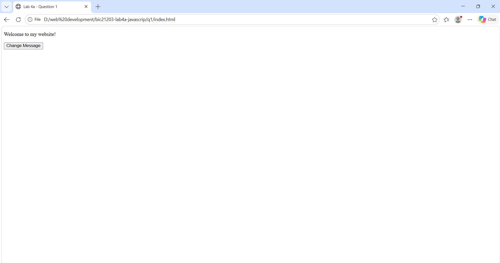
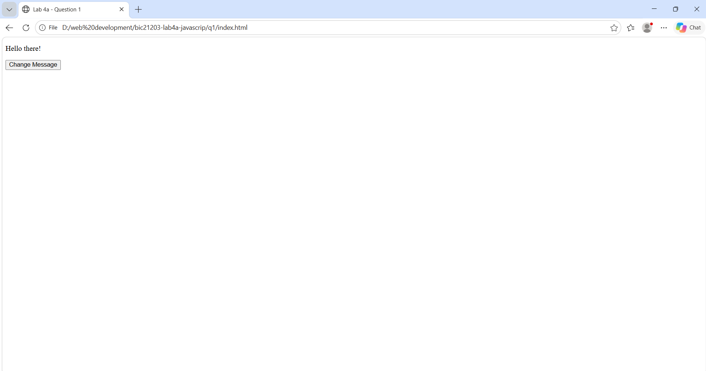
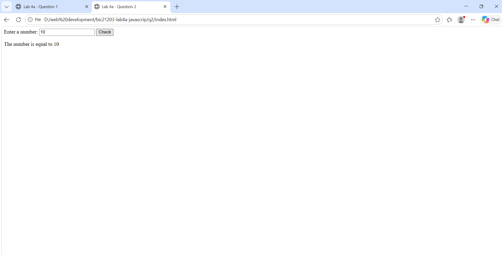
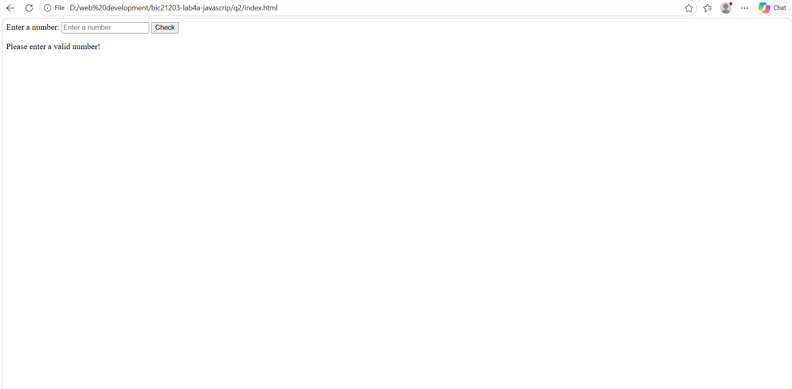
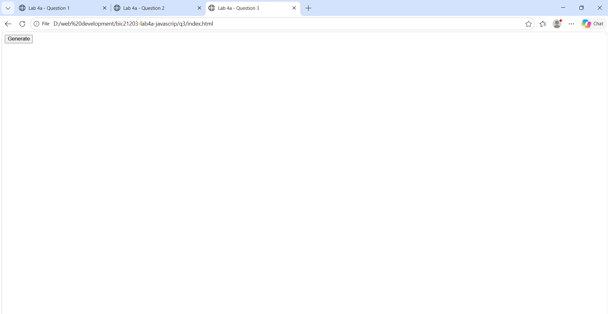
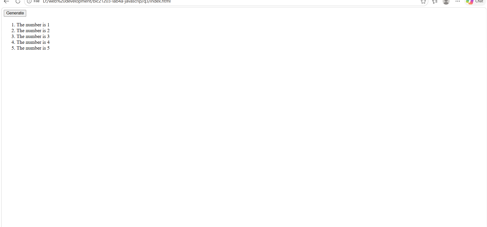

# BIC21203 Web Development — Lab #4a: Client-Side Scripting (JavaScript)

- **Name:** ALICE ANG LI SHIER
- **Matric No:** DI240072
- **Course:** BIC21203 Web Development (Academic Session 2026/2027)

## Project Overview
This repository contains client-side JavaScript solutions for Lab #4a, demonstrating DOM manipulation, event handling with `addEventListener()`, input validation, and loop-based dynamic element generation.

## How to Run
1. Clone or download this repository.
2. Open any question folder (`q1/`, `q2/`, or `q3/`).
3. Open `index.html` in a modern desktop web browser (or via VS Code Live Server).

## Questions & Outputs

### Question 1: Interactive Text Changer (`q1/`)
Updates the paragraph text from `"Welcome to my website!"` to `"Hello there!"` when the **Change Message** button is clicked.

### Question 2: Smart Number Validator (`q2/`)
Validates user input to reject empty strings and non-numeric text, and compares valid numbers (including decimals) against `10`.

### Question 3: Dynamic Number Generator (`q3/`)
Uses a `for` loop (`1` to `5`) and `document.createElement("li")` to generate an ordered list while clearing previous items on repeat clicks.

